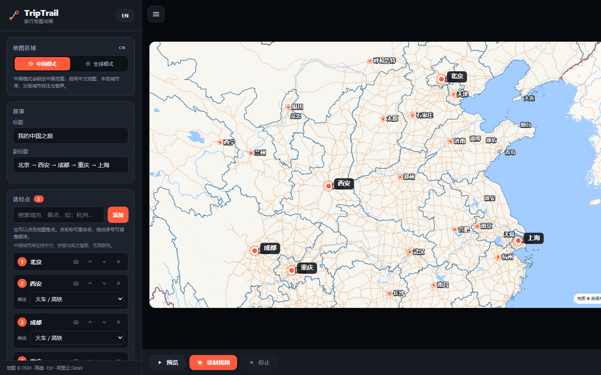

# TripTrail · 中文增强版

把一段旅程做成电影感的地图动画，直接在浏览器里完成。

本仓库基于 [Fangyuan025/triptrail](https://github.com/Fangyuan025/triptrail) 修改，重点增强了中文界面与中国地图体验。



## 本版新增

- **完整中文界面 + 中英文切换**：界面默认中文，右上角 `EN / 中` 一键切换。标题、按钮、提示、路线说明、途经点名称、城市标注都会跟随语言变化。
- **中国模式**：默认锁定中国范围，自动使用中文地图、中国省/市边界、本地城市库与分级城市标注；也可以随时切回全球模式。
- **更好的中国底图**：新增高德中文路网、高德卫星影像，保留 Esri 卫星、CARTO、OpenFreeMap 等多种全球地图样式。
- **离线中国城市库**：内置 3,200 个城市/区县与 522 个景点，支持中文、拼音和英文搜索，例如 `杭州`、`hangzhou`、`西湖`、`故宫`、`鹿回头`。断网时城市搜索仍可用。
- **城市分级标注**：省会/直辖市 → 地级市 → 区县随缩放逐级出现，支持“自动分级 / 仅省会 / 省会+地级市 / 全部”四档。城市标注使用 Canvas 绘制，导出的视频里也会显示。
- **途经点始终置顶**：所有已添加的途经点与名称始终绘制在城市标注之上，预览和导出都不会被城市名遮住。
- **更细的中国边界**：省级、地级和直辖市辖区边界使用本地 GeoJSON，按缩放显示，不依赖在线边界接口。
- **中文路线描述**：支持“北京到西安坐高铁，再去成都”这类写法；文本定位优先使用本地城市库，找不到时才走在线 Nominatim。
- **自定义地点**：可输入名称、经度和纬度直接落点；自定义地点会记入本机常用地点，并参与后续搜索。
- **配置文件**：一键保存/载入 `.triptrail.json`，包含标题、途经点、交通方式、地图设置、媒体间隔和自定义地点。图片/GIF/视频不嵌入配置文件。
- **停靠点多媒体系列**：每个途经点可添加多张图片、GIF、视频或 Live Photo，多张卡片叠放轮播，顶部卡片播放完会带动画沉到最下方；一轮结束后自动前往下一个途经点。
- **GIF / 视频 / Live 播放**：GIF 使用 WebCodecs `ImageDecoder` 解码为逐帧画面，预览与逐帧导出都能播放；视频和 Live 使用隐藏的 `<video>` 播放并绘制到动画画布。含视频的行程会自动改用实时录制，保证画面同步。
- **本地依赖**：MapLibre GL 与 MP4 muxer 已放入 `vendor/`，不依赖 CDN 加载核心脚本。

## 快速开始

需要 Node.js 18+，无需安装任何 npm 依赖：

```bash
git clone https://github.com/Fangyuan025/triptrail.git
cd triptrail
npm start
```

然后打开 **http://127.0.0.1:8742**。

如果 8742 端口被占用：

```powershell
$env:PORT=8743; npm start
```

也可以直接用任意静态服务器托管本目录。不要用 `file://` 打开，地图与 JSON 数据需要 HTTP。

## 使用说明

1. 顶部“地图区域”选择 **中国模式** 或 **全球模式**。
2. 在“途经点”里搜索城市、区县或景点，也可以直接点击地图落点；展开“手动添加自定义地点”可输入名称和经纬度。
3. 点途经点右侧相机按钮，可一次选择多张图片/GIF/视频。同名 JPG/PNG + MOV/MP4 会自动配成 **Live Photo**。每个途经点下方可单独设置媒体停留间隔。
4. 在“路线生成”里输入整段行程，或导入 GPX / KML / GeoJSON。“项目配置”可保存/载入整个行程配置。
5. 在“外观”里切换高德路网、高德卫星、Esri 卫星等 9 种底图，调整比例、主题色、节奏与默认媒体间隔。
6. 在“中国地图显示”里选择城市级别，控制省/市边界和分级城市。
7. 点“预览”检查动画，点“录制视频”导出 MP4/WebM。

> 录制 MP4 使用浏览器 WebCodecs，建议使用最新版 Chrome / Edge。录制时请保持页面可见。
>
> 含视频/Live 的行程会自动使用实时录制（以保证视频帧同步）；纯图片/GIF 会走逐帧离线渲染。

### 路线真实性说明

- **汽车、大巴、房车、摩托、自行车、步行**：使用 OSRM 的真实道路网络，路线会贴合道路。
- **火车 / 高铁**：当前沿地面走廊（OSRM 道路 + 距离上限）生成，**不是铁路轨道**。公开可用的铁路路由服务不稳定，因此这一版没有强行实现“铁路专用线路”；UI 中会标记“地面走廊”。
- **飞机**：大圆航线；**轮船**：内置 SeaRoute 海运网络。

如果你有自建的 OpenRailRouting / OSRM rail 服务，可以扩展 `osrmRoute` 或新增 rail 请求分支接入；动画与导出引擎不需要改动。

## 地图与数据

| 内容 | 来源 |
|---|---|
| 中国省/市/区县边界 | [阿里云 DataV 行政区划](https://datav.aliyun.com/portal/school/atlas/area_selector)（本地简化后文件） |
| 中国城市/区县坐标 | DataV 行政区划中心点 + [GeoNames](https://www.geonames.org/)（CC BY 4.0） |
| 常见景点（137 条） | 本项目整理，仅用于地点搜索 |
| 城市 Top10 景点（385 条，来自 40 个城市） | [james0618-yang/travel-top10](https://github.com/james0618-yang/travel-top10)（高德 POI 衍生数据，已转 GCJ-02） |
| 高德中文路网 / 卫星 | 高德地图公开栅格瓦片（版权归高德） |
| Esri 卫星 | Esri World Imagery |
| 全球矢量底图 | CARTO / OpenFreeMap / VersaTiles |
| 在线地理编码 | Nominatim（OpenStreetMap） |
| 公路道路 | OSRM demo server / routing.openstreetmap.de |
| 铁路走廊 | 沿 OSRM 地面道路（非铁路轨道） |
| 海运网络 | Eurostat SeaRoute |

底图瓦片、Nominatim 与 OSRM 都需要联网；本地城市搜索、中国边界和路线预览不依赖这些在线服务。

### 坐标说明

DataV 与高德瓦片使用 GCJ-02 坐标体系，本项目的中国城市库与边界按此体系使用，因此在高德底图上对齐最好。切换到 Esri/WGS-84 卫星影像时，可能出现数百米级偏移，这是国内地图坐标体系的固有限制。用于导航或测绘前请自行做坐标纠偏。

### 使用条款

高德、Esri、CARTO、OpenFreeMap 等瓦片均有各自的服务条款。本项目仅用于个人学习与演示；商用或公开部署前，请确认相应地图服务的授权要求。

## 目录结构

```
index.html                  界面
i18n.js                     中英文文案
app.js                      地图、路线、搜索、动画、导出
style.css                   界面样式
server.mjs                  零依赖本地静态服务器
data/china-cities.json      3,200 个城市/区县 + 137 个精选景点
data/china-pois-extra.json  40 个城市的 Top10 景点（385 条）
data/china-provinces.geojson
data/china-prefectures.geojson
data/china-districts.geojson
vendor/maplibre/            本地 MapLibre GL
vendor/mp4-muxer.mjs        本地 MP4 muxer
```

## 开发与数据重建

运行 `node scripts/fetch-assets.mjs` 可重新下载原始 DataV/GeoNames 数据；`scripts/build-china-data.mjs` 会生成运行时的简化边界和城市索引，`scripts/build-extra-pois.mjs` 会重新生成城市 Top10 景点。重建脚本需要：

```bash
npm install --prefix scripts
node scripts/fetch-assets.mjs
node scripts/build-china-data.mjs
node scripts/build-extra-pois.mjs
```

## 许可证

MIT。原始项目版权归 Fangyuan Lin 所有，详见 [LICENSE](LICENSE)。

地图数据版权归各自来源所有。
